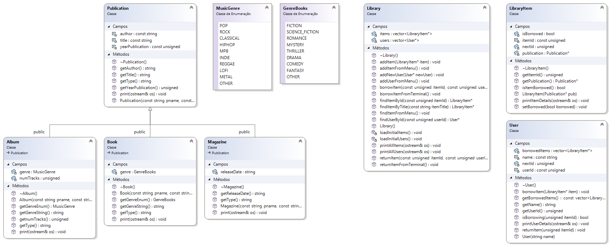

# Library Simulator (C++)

An object-oriented library system in C++. The library lends three kinds of items: books, magazines and
music albums. From a console menu you can add items, register users, borrow and return items, search the
collection and list everything.

## What it does

| Option | What happens |
|---|---|
| 1. Add Item | Adds a book (with its genre), a magazine (with its release date) or an album (with its number of tracks and music genre). |
| 2. Register User | Creates a user. IDs are given automatically. |
| 3. Borrow Item | Lends an item to a user, by item ID and user ID. A user can borrow several items. |
| 4. Return Item | Gives an item back. |
| 5. Search Item by ID/Title | Finds an item by its ID or its title. |
| 6. List Collection | Shows every item with its details and whether it is available. |
| 7. List Users | Shows every user and what they borrowed. |

Option 0 closes the program.

The program starts with 9 books, 6 magazines, 5 albums and 15 users. Everything is kept in memory, so the
items and users you add are gone when the program closes.

## How to run

Open `LibrarySim.sln` in Visual Studio 2022, with the "Desktop development with C++" workload installed,
and press Ctrl+F5. The program is made for Windows: it clears the screen with `system("cls")`.

## How the code is organized

| Class | Role |
|---|---|
| `Publication` | Base class with the title, author and year. `getType()` and `print()` are virtual. |
| `Book`, `Magazine`, `Album` | Inherit from `Publication` and add their own fields: genre, release date, number of tracks. |
| `LibraryItem` | Wraps a publication with a unique ID and whether it is borrowed. |
| `User` | A user with an ID and the list of items they borrowed. |
| `Library` | Owns every item and user, and carries out every operation. |

`Functions.cpp` has the menu, the ASCII-art titles and the helpers that center text on the screen. The
comments in the code are in Hungarian.
